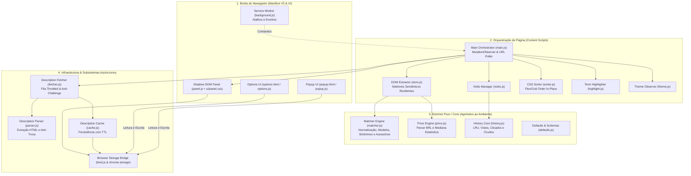
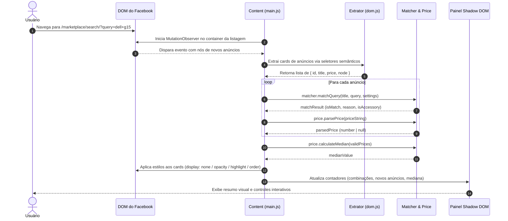

# Arquitetura do Marketplace Smart Filter

> **Status:** Ativo / Produção  
> **Última Atualização:** 2026-10-29  
> **Diretrizes e Restrições:** Consulte [`AGENTS.md`](../AGENTS.md) para o Quality Ratchet, regras inegociáveis e limites de complexidade.

---

## 1. Visão Geral e Objetivos

O **Marketplace Smart Filter** é uma extensão para navegadores Chromium (Google Chrome, Brave, Microsoft Edge, Opera) desenvolvida em **Manifest V3**. O objetivo principal do sistema é atuar como uma camada autônoma e inteligente de curadoria e higienização em tempo real sobre os resultados de busca do Facebook Marketplace.

A extensão elimina ruídos comuns em marketplaces abertos: acessórios indesejados quando o usuário busca aparelhos principais (ex.: capas e carregadores em buscas de smartphones), variações tipográficas incorretas de modelos, preços simbólicos ou suspeitos de fraude (golpes), além de possibilitar a detecção de anúncios recém-publicados e ordenação determinística por preço sem quebrar a paginação nativa da aplicação consumida.

### Requisitos Não-Funcionais Críticos

- **Isolamento e Segurança (Zero DOM Pollution):** O painel de controle flutuante é injetado através de **Shadow DOM**, garantindo encapsulamento de estilos bidirecional (o CSS do Facebook não desconfigura a extensão e o CSS da extensão não colide com o site).
- **Processamento 100% Local (Zero Telemetria):** Nenhuma requisição externa é despachada para servidores de terceiros. Cálculos estatísticos, parsers e histórico residem exclusivamente na memória e na API nativa `chrome.storage`.
- **Seletores Semânticos Resilientes:** Não há dependência de classes CSS ofuscadas geradas dinamicamente pelo React do Facebook. A ancoragem de dados baseia-se em atributos semânticos estáveis (como links com padrão `/marketplace/item/<id>` e parâmetros de URL).
- **Lógica Pura e Testabilidade:** Todos os módulos de domínio e regras de negócio (`src/core/`) são funções puras em JavaScript (sem DOM, sem `window` e sem `chrome.*`), permitindo 100% de cobertura com execução headless rápida via `node --test`.
- **Comportamento Educado e Anti-Ban:** O subsistema de inspeção de descrições opera com fila assíncrona limitada por taxa (rate-limited), cache LRU e detecção proativa de telas de bloqueio de login para evitar penalizações pelo servidor do Facebook.

---

## 2. Visão em Camadas (Clean Architecture no Navegador)

A arquitetura organiza-se em camadas bem delimitadas, desacoplando o ambiente de execução do navegador da lógica de negócio pura:



---

## 3. Responsabilidades por Componente

| Componente | Localização | Responsabilidade Principal | Dependências |
| :--- | :--- | :--- | :--- |
| **Service Worker** | `src/background.js` | Escuta atalhos globais de teclado (`Alt+Shift+F`) e gerencia a navegação inicial para a página de opções. | `chrome.commands`, `chrome.runtime` |
| **Main Orchestrator** | `src/content/main.js` | Inicializa a extensão na página, observa mutações no DOM do feed de anúncios, gerencia ciclo de vida e responde a alterações em `chrome.storage`. | `MutationObserver`, módulos de `content/` e `core/` |
| **DOM Extractor** | `src/content/dom.js` | Localiza e extrai metadados dos cards de anúncios (ID, título, preço, elemento de container) com seletores estáveis baseados em links `/marketplace/item/`. | DOM do Facebook |
| **Shadow DOM Panel** | `src/content/panel.js` | Injeta e gerencia a interface do painel flutuante encapsulada em Shadow DOM, isolando estilos via CSS Custom Properties. | `ShadowRoot`, `ui/panel.css` |
| **Matcher Engine** | `src/core/matcher.js` | Avalia títulos de anúncios contra a busca do usuário. Implementa normalização semântica de modelos (ex.: `g-15` = `g15`), dicionário de sinônimos, suporte a operadores (`-` e `"..."`), distância Levenshtein e filtro de acessórios. | Nenhuma (Módulo Puro) |
| **Price Engine** | `src/core/price.js` | Faz o parsing de strings monetárias em Real brasileiro (BRL), calcula a mediana estatística do conjunto de anúncios relevantes e sinaliza ofertas suspeitas (< 50% da mediana com quorum >= 5). | Nenhuma (Módulo Puro) |
| **History Core** | `src/core/history.js` | Mantém coleções delimitadas de IDs vistos, abertos e excluídos com política de expiração para não saturar limites de armazenamento. | Nenhuma (Módulo Puro) |
| **Description Fetcher** | `src/descriptions/fetcher.js` | Fila assíncrona throttled para requisição educada de páginas de detalhes em segundo plano com detecção de tela de login. | `fetch`, `src/descriptions/cache.js` |
| **UI Design System** | `ui/` | Conjunto compartilhado de tokens de design (`tokens.css`), componentes visuais (`components.css`) e vinculação reativa bidirecional (`bind.js`). | `chrome.storage` |

---

## 4. Estrutura Canônica de Diretórios

```text
marketplace_smart_filter/
├── manifest.json              # Configuração Manifest V3 da extensão
├── package.json               # Configurações de desenvolvimento e testes Node.js
├── icons/                     # Ícones em 16px, 48px e 128px
├── src/
│   ├── background.js          # Service Worker: atalho de teclado e comandos de navegação
│   ├── core/                  # Módulos puros de domínio (sem dependência de DOM ou Chrome API)
│   │   ├── defaults.js        # Fonte única da verdade para preferências e opções padrão
│   │   ├── history.js         # Coleção delimitada de histórico (vistos, abertos, ocultos)
│   │   ├── matcher.js         # Motor de correspondência semântica, fuzzy e filtros negativos
│   │   └── price.js           # Parser financeiro em BRL e algoritmo de mediana estatística
│   ├── descriptions/          # Subsistema assíncrono de enriquecimento de anúncios
│   │   ├── cache.js           # Cache persistente em memória/storage com TTL e despejo LRU
│   │   ├── fetcher.js         # Fila assíncrona educada (rate-limited) com detecção de captcha
│   │   └── parser.js          # Extrator semântico de descrição do HTML bruto
│   └── content/               # Orquestração do Content Script dentro do DOM do Facebook
│       ├── content.css        # Folha de estilos injetada para cards e indicadores visuais
│       ├── dom.js             # Seletores estáveis e extração de nós de anúncios
│       ├── highlight.js       # Realce seguro de termos correspondentes nos títulos
│       ├── main.js            # Ponto de entrada, MutationObserver e sincronização reativa
│       ├── panel.js           # Painel flutuante encapsulado dentro de Shadow DOM
│       ├── sorter.js          # Reordenação visual in-place via propriedade CSS order
│       ├── theme.js           # Detecção dinâmica de tema claro/escuro do Facebook
│       └── visits.js          # Rastreamento de primeira visita vs. anúncios recém-descobertos
├── ui/                        # Design System compartilhado entre Popup, Options e Painel
│   ├── bind.js                # Two-way data binding entre formulários e chrome.storage
│   ├── components.css         # Componentes reutilizáveis (switches, inputs, botões)
│   ├── panel.css              # Estilos exclusivos do painel flutuante
│   └── tokens.css             # Variáveis CSS (cores, tipografia, espaçamentos, elevação)
├── popup/                     # Painel de acesso rápido da barra de ferramentas
│   ├── popup.html             # Marcação do popup
│   ├── popup.js               # Lógica de controle do popup
│   └── popup.css              # Estilos do popup
├── options/                   # Página completa de configurações da extensão
│   ├── options.html           # Marcação da página de opções
│   ├── options.js             # Controlador de salvamento e reset de regras
│   └── options.css            # Estilos da página de opções
├── tests/                     # Bateria de testes automatizados com Node.js nativo
│   ├── content.test.js        # Testes de integração de content scripts simulados via JSDOM
│   ├── core.test.js           # Testes unitários do motor matcher e parser de preços
│   ├── descriptions.test.js   # Testes de fila, parser de descrição e cache LRU
│   └── support/               # Mocks e utilitários de suporte a testes
├── tools/                     # Scripts utilitários de qualidade
│   └── check-no-comments.js   # Validador de ausência de comentários em código de produção
├── docs/                      # Documentação de arquitetura e decisões de engenharia
│   ├── architecture.md        # Este documento (mapa arquitetural do sistema)
│   ├── adr/                   # Architecture Decision Records
│   │   └── 0000-template.md   # Modelo para novos registros arquiteturais
│   └── agents.md              # Catálogo de personas e orquestração de IA
├── AGENTS.md                  # Restrições inegociáveis, Clean Code e qualidade
├── CHANGELOG.md               # Histórico de alterações seguindo Keep a Changelog + SemVer
└── README.md                  # Documentação para desenvolvedores e usuários finais
```

---

## 5. Fluxo de Dados e Ciclo de Vida da Filtragem



---

## 6. Padrões de Design e Diretrizes de Engenharia

### 1. Injeção Visual In-Place (CSS `order`)
Em aplicações SPA de página única gerenciadas por frameworks reativos como o React do Facebook, deletar ou mover fisicamente elementos do DOM pode causar dessincronização no Virtual DOM e quebrar o carregamento contínuo (infinite scroll). Por esse motivo, a extensão aplica reorganização visual puramente através da propriedade CSS `order` em contêineres `display: flex` / `grid`, mantendo a integridade da árvore do navegador.

### 2. Separação Estrita de Ambientes (Isomorphic Core)
A pasta `src/core/` possui zero referências a APIs de navegador (`window`, `document`, `chrome`). Isso garante:
- **Execução Ultrarrápida em Testes:** A suíte de testes roda diretamente no Node.js (`node --test`) sem necessidade de instanciar emuladores pesados de browser para lógica de parsing.
- **Portabilidade:** Os mesmos módulos de validação semântica podem ser reutilizados tanto no Content Script quanto no Service Worker ou em workers de background.

### 3. Isolamento Visual com Shadow DOM
O painel de opções interativas injetado diretamente na página do Marketplace utiliza `element.attachShadow({ mode: 'open' })`. Isso impede vazamento de regras CSS globais do Facebook (que utilizam seletores de alta especificidade) para os componentes da extensão e garante fidelidade de renderização em qualquer atualização de layout da rede social.
